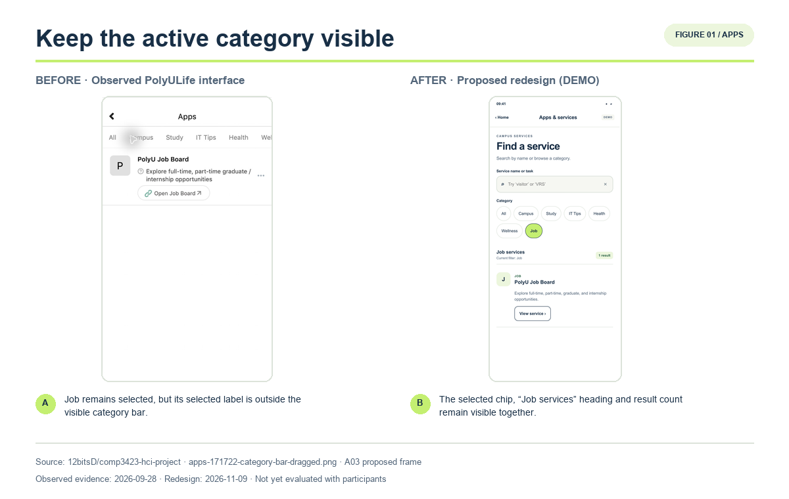
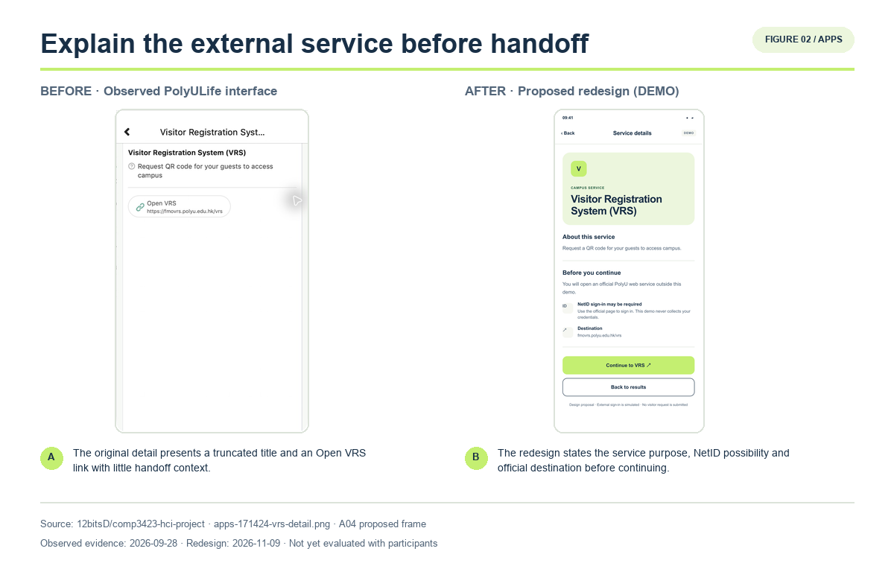
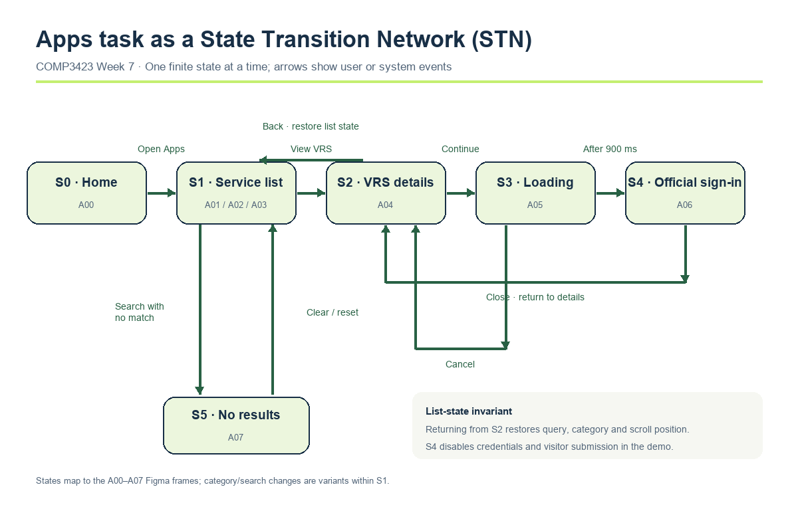

# Apps and Service Discovery — Report-ready Subsection

Status: design and implementation draft, 2026-11-09. Real-participant results and the final Figma link remain to be inserted. The analysis below uses COMP3423 lecture frameworks first and treats Nielsen’s heuristics as supporting terminology. It does not claim an improvement that has not been evaluated.

## User task and observed problem

The Apps module supports students who need to locate a campus service without necessarily knowing its category. The core task is to find the Visitor Registration System (VRS), understand its purpose, open the official service, and return to the service list. VRS allows a user to request a QR code for guests to access campus.

The original interface was observed in PolyULife 3.0.0 on 28 September 2026. After Job was selected, the horizontal category bar was dragged to reveal earlier categories. The content still showed PolyU Job Board and the accessibility state still identified Job as selected, but the selected Job label was no longer visible. The interface therefore did not provide sufficient visible feedback about the current filter state. This observation does **not** establish how often users become confused or fail; it defines an evidence-based hypothesis for evaluation rather than a quantified defect.

*Figure X. In the observed interface, the active Job label can leave the visible category bar. The proposed interface keeps the selected chip, result heading, current-filter label, and result count visible together. Source: project evidence `apps-171722-category-bar-dragged.png`; redesign dated 9 November 2026.*

## Course-led redesign rationale

The redesign decisions map directly to COMP3423 lecture principles:

| Lecture principle | Observed need | Implemented response |
| --- | --- | --- |
| **Feedback — Week 7, Part 1, pp. 1–2** | The selected category could be absent from the visible controls, leaving users to infer the current state from the content. | Category selection updates the chip, result heading, `Current filter`, and result count. External loading identifies the destination and provides a visible response to Continue. |
| **Recognition over recall — Visuals Part 2, p. 75** | Users may not know the exact category or official service name. | Search accepts service names and task words such as `visitor`, while descriptive result cards support recognition. Category browsing remains available. |
| **Semantic Priming — Visuals Part 2, pp. 28–34, 58–60** | A truncated VRS title and a bare external link provide limited context for novices, who may rely on first associations or trial-and-error. | The detail page supplies the full name, guest-QR purpose, possible NetID requirement, and official destination before the user continues. Buttons use explicit labels rather than unfamiliar icons. |
| **Constraints — Week 7, Part 1, pp. 2–4** | External navigation and query recovery can produce unintended context loss or unsafe demonstration behaviour. | Continue is a deliberate handoff action; loading can be cancelled and the web view closed. Clear search and category reset are distinct recovery actions. Demo credential fields and visitor submission are disabled. |
| **CRAP — Visuals Part 2, p. 70; organisation p. 72** | Filter controls, state feedback, and results need to be perceived as one related task region. | **Contrast** distinguishes primary and secondary actions; **Repetition** gives service cards and chips consistent formats; **Alignment** uses a shared grid; **Proximity** groups each service’s name, purpose, and action. |
| **Fitts’ Law — Human Part 2, pp. 27–35** | Small or distant controls increase pointing difficulty, especially for novice touch users. | Primary actions use at least 44 px targets and sit near their related content. This is a qualitative application of the law, not a measured movement-time claim. |

The redesigned directory provides two complementary routes. Users can browse wrapped category chips or search by a service name and related task words. The persistent result summary gives immediate feedback after every filter or query change. This course-based explanation also supports Nielsen’s **visibility of system status** and **recognition rather than recall**, but those external heuristics are secondary to the lecture terminology.

The VRS detail page makes the external transition explicit before the user continues. It states the service purpose, possible NetID requirement, and official destination (`fmovrs.polyu.edu.hk/vrs`). A loading page identifies the service being opened and offers cancellation. Back and close actions restore the previous list state, preventing an external detour from discarding the user’s context.

*Figure X. The original VRS detail and the proposed detail page. Semantic priming and feedback explain the service and destination before handoff. The observed link worked; the redesign addresses clarity rather than claiming to repair a broken link.*

## UI specification and state model

Following **Week 5’s requirement to make functional and non-functional specifications precise and measurable (pp. 2–5)**, the Apps prototype uses these acceptance conditions:

- **Functional:** filter by category; search by name/task words; present matching service names and purposes; open VRS details; show loading and official sign-in states; provide no-results recovery; return with query, category, and scroll position preserved.
- **Usability:** every list variant displays the active filter and result count; primary targets are at least 44 px; state is not communicated by colour alone; Maze records direct/indirect success, time, wrong turns, and ease ratings.
- **Evaluation safety:** no credentials, live authentication, visitor requests, or external submissions are collected.

The **Finite State Machine / State Transition Network from Week 7, Part 1, pp. 8–10** makes the navigation and feedback states explicit. Category and query changes are variants within S1; they do not create an uncontrolled collection of unrelated screens.

*Figure X. Apps task STN. S0–S5 correspond to the A00–A07 frames. The main path is Home → Service list → VRS details → Loading → Official sign-in. Back, Close, Cancel, Clear, and Reset provide defined recovery transitions. Returning from details preserves the list-state invariant.*

## Prototype and evaluation plan

The eight principal frames implement the states above. Interactive targets use the shared Fresh Campus typography, colour tokens, and CRAP-based organisation. The current browser implementation verifies these behaviours, but the editable Figma migration and Present walkthrough remain a separate completion requirement.

This process follows **Week 6’s iterative Design Thinking model (pp. 2–3)**. Interface observation and the problem statement support Define; the two discovery routes and external handoff support Ideate; A00–A07 form the Prototype. Empathize requires the group’s user-research evidence and must not be claimed from interface inspection alone. Test will use real participants and feed any resulting changes back into the prototype.

The Maze task will ask at least five real target users to find the service for requesting a guest campus QR code, review what is required, open the official service page, and return to the service list. The wording does not reveal “Apps”, “search”, “Campus”, or “VRS” as a click path. We will record direct and indirect success, completion time, wrong turns, and participant comments. Post-task questions will ask participants to identify the active filter and describe what they expect before external sign-in. These measures test the Feedback and Semantic Priming decisions; Fitts’ Law is not presented as quantitatively validated without suitable pointing measurements.

**Results and iteration — to be completed after real testing.** Insert the participant count, raw Maze export/dashboard reference, per-task outcomes, representative quotations, and specific design changes. Agent walkthroughs verify only implemented links and state restoration; they are not participant evidence.

## Course sources and candidate external references

Lecture slides define the course framework used for design justification; they do not replace the project requirement for 10–20 relevant research references across the full report.

- Tang, J. (2026). *COMP3423 Week 7 – Part 1: Interface Design Principles*, especially Feedback and Constraint (pp. 1–4) and FSM/STN (pp. 8–10).
- Tang, J. (2026). *COMP3423 Visuals Part 2*, especially Semantic Priming (pp. 28–34, 58–60), CRAP (p. 70), organisation (p. 72), and recognition over recall (p. 75).
- Tang, J. (2026). *COMP3423 Week 5 – User Spec* (pp. 2–5); *Week 6 – Design Thinking* (pp. 2–3); *Human Part 2*, Fitts’ Law (pp. 27–35).
- Nielsen, J. (1994). *Usability Engineering*. Morgan Kaufmann. Supporting terminology for visibility, recognition, and user control.
- Adar, E., Teevan, J., & Dumais, S. T. (2008). Large scale analysis of web revisitation patterns. *Proceedings of CHI 2008*, 1197–1206. https://doi.org/10.1145/1357054.1357241. Candidate context for revisitation and search-assisted recognition; the related-work author should evaluate its relevance and synthesis rather than adding it as an isolated summary.
